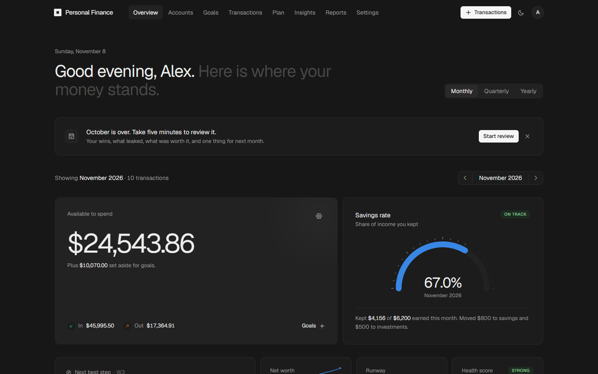
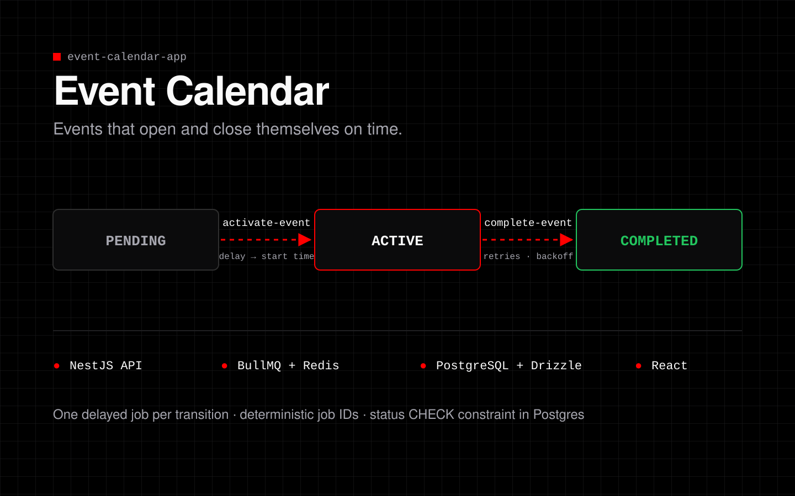
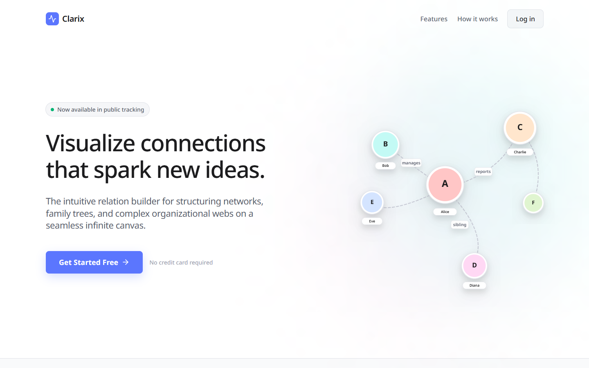
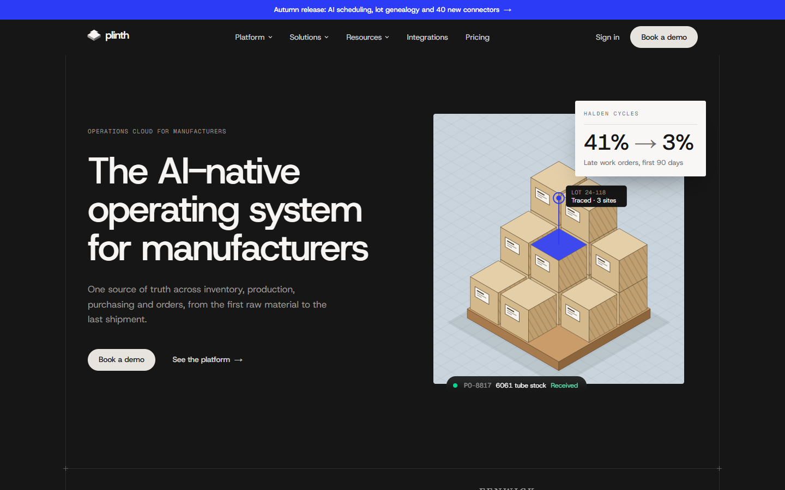

  
  
  
  

  I build the React screens people click and the Node.js services behind them, 
  then write the tests that keep both working in production.

 

## 🟥 What I build at FlowAppz

Junior Full Stack JavaScript Developer at [**FlowAppz**](https://flowappz.com) since Aug 2026 (intern from May). Four Webflow apps in TypeScript monorepos: Express and Next.js APIs on PostgreSQL, Redis and BullMQ job queues, and React extensions that run inside the Webflow Designer. **300+ commits.**

<table>
  <tr>
    <td width="50%" valign="top">
      <h3>⏱ Scheduled CMS Publisher</h3>
      <code>Express</code> <code>Drizzle</code> <code>BullMQ</code> <code>Redis</code> <code>Playwright</code>
      <ul>
        <li>BullMQ jobs that survive a deploy</li>
        <li>Refresh-token rotation with reuse detection</li>
        <li>Per-site rate limits in Redis</li>
        <li>Schedules that stay correct when a site changes time zone</li>
      </ul>
    </td>
    <td width="50%" valign="top">
      <h3>🧩 Multistep Form · top committer</h3>
      <code>Express</code> <code>Prisma</code> <code>PostgreSQL</code> <code>React Query</code>
      <ul>
        <li>Rebuilt session auth on every route</li>
        <li>Every query scoped to the caller's site</li>
        <li>Signed CDN releases with integrity hashes</li>
        <li>Webhooks moved from the browser to the server</li>
      </ul>
    </td>
  </tr>
  <tr>
    <td width="50%" valign="top">
      <h3>🔎 Advanced Search</h3>
      <code>Express</code> <code>MeiliSearch</code> <code>BullMQ</code> <code>Drizzle</code>
      <ul>
        <li>Webhook-driven re-indexing</li>
        <li>A burst of edits collapses into one job</li>
        <li>Ranking across collections, licence checks</li>
      </ul>
    </td>
    <td width="50%" valign="top">
      <h3>💳 Memberflow</h3>
      <code>Next.js</code> <code>Prisma</code> <code>Stripe</code> <code>Resend</code>
      <ul>
        <li>Stripe webhooks and in-place plan upgrades</li>
        <li>Auth templates and 81 Webflow components</li>
        <li>Closed an open redirect</li>
      </ul>
    </td>
  </tr>
</table>

The code is private. <a href="https://ashikurrahman.vercel.app/#quests">My site</a> has more detail.

 

## 🟥 Projects you can read

<table>
  <tr>
    <td width="50%" valign="top">
      
      <h3><a href="https://github.com/The-BlackShadoww/personal-finance">Personal Finance</a></h3>
      Multi-tenant money app: JWT with refresh cookies, Google OAuth, TOTP 2FA, CSP, money stored as integer minor units, unit-tested calculations. Built with Claude Code as my pair programmer.
        
      <code>NestJS</code> <code>PostgreSQL</code> <code>Drizzle</code> <code>Next.js 15</code> <code>TanStack Query</code>
        
      <a href="https://bank-ar.vercel.app"><b>Live demo →</b></a>
    </td>
    <td width="50%" valign="top">
      
      <h3><a href="https://github.com/The-BlackShadoww/event-calendar-app">Event Calendar</a></h3>
      Delayed BullMQ jobs open and close each event on time, with retries and backoff. Postgres and Redis in one Docker Compose file.
        
      <code>NestJS</code> <code>PostgreSQL</code> <code>Drizzle</code> <code>Redis</code> <code>BullMQ</code> <code>React</code>
        
      <a href="https://github.com/The-BlackShadoww/event-calendar-app"><b>Source →</b></a>
    </td>
  </tr>
  <tr>
    <td width="50%" valign="top">
      
      <h3><a href="https://github.com/The-BlackShadoww/clarix">Clarix</a></h3>
      Infinite-canvas relation builder for networks, family trees and org charts, with SVG links that follow your drag.
        
      <code>Next.js</code> <code>TypeScript</code> <code>Framer Motion</code>
        
      <a href="https://clarix-six.vercel.app"><b>Live demo →</b></a>
    </td>
    <td width="50%" valign="top">
      
      <h3><a href="https://github.com/The-BlackShadoww/landing">Plinth</a></h3>
      Concept landing page with isometric illustrations drawn in code and GSAP motion. Built with Claude Code in four days.
        
      <code>Next.js 16</code> <code>Tailwind CSS v4</code> <code>GSAP</code>
        
      <a href="https://landing-beta-bice-47.vercel.app"><b>Live demo →</b></a>
    </td>
  </tr>
</table>

 

## 🟥 Tech stack

<table>
  <tr>
    <td width="130"><b>Frontend</b></td>
    <td></td>
  </tr>
  <tr>
    <td><b>Backend</b></td>
    <td></td>
  </tr>
  <tr>
    <td><b>Data</b></td>
    <td></td>
  </tr>
  <tr>
    <td><b>Testing &amp; shipping</b></td>
    <td></td>
  </tr>
</table>

 

## 🟥 Off the clock

I studied psychology at the University of Dhaka, which helps more than you'd expect when building for real users. Basketball when I'm away from the keyboard.

 

<picture>
  <source media="(prefers-color-scheme: dark)" srcset="https://raw.githubusercontent.com/The-BlackShadoww/The-BlackShadoww/output/snake-dark.svg" />
  <source media="(prefers-color-scheme: light)" srcset="https://raw.githubusercontent.com/The-BlackShadoww/The-BlackShadoww/output/snake-light.svg" />
  
</picture>
